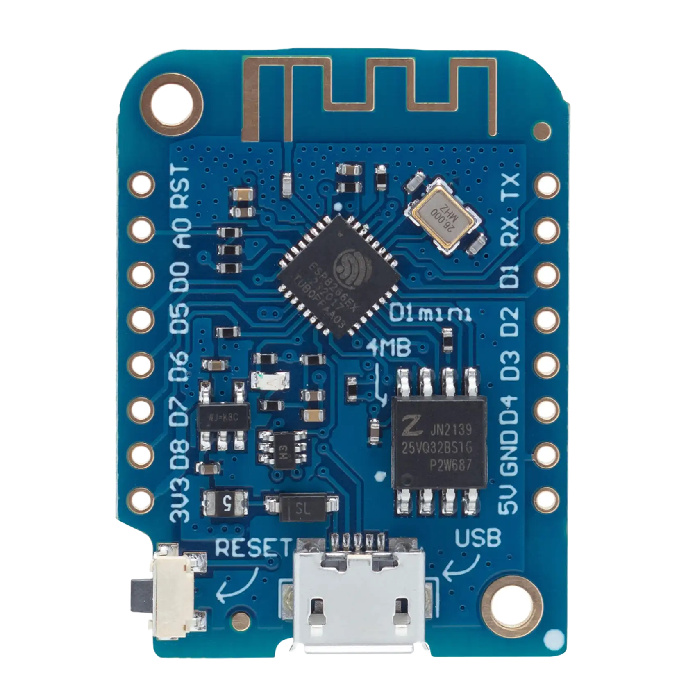
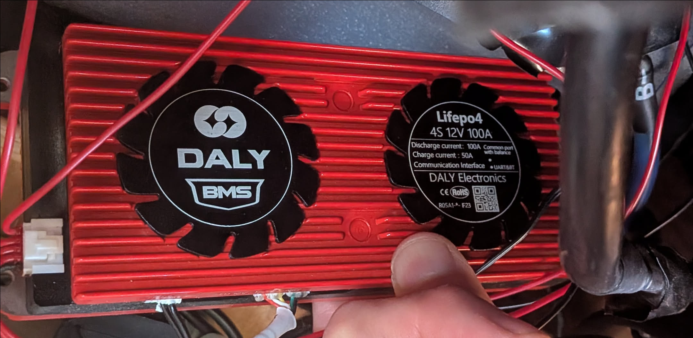
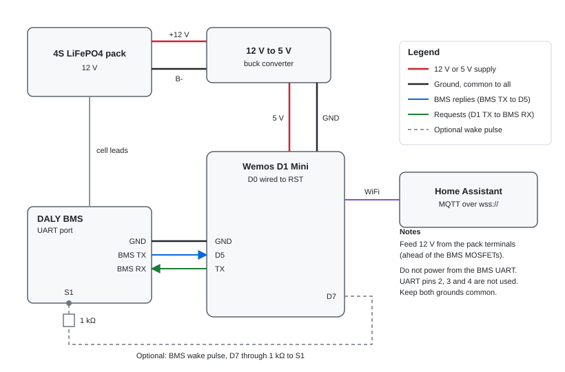

# DALY BMS to Home Assistant

A Wemos D1 Mini reads a DALY battery management system (BMS) over its UART port and publishes the pack data to Home Assistant over MQTT. The data travels over a WebSocket (`wss://`), so it works through a reverse proxy on port 443. The board also serves a small web dashboard.

<table>
  <tr>
    <td align="center" width="50%"> Wemos D1 Mini (ESP8266)</td>
    <td align="center" width="50%"> DALY 4S 12 V 100 A BMS</td>
  </tr>
</table>

The board is the Luxorparts Wemos D1 Mini from [Kjell](https://www.kjell.com/se/produkter/el-verktyg/elektronik/arduino/utvecklingskort/luxorparts-wemos-d1-mini-utvecklingskort-p87294) (article 87294).

## Connection

| BMS UART port | Wemos D1 Mini |
|---|---|
| Pin 1 (GND) | GND |
| Pin 5 (TX) | D5 |
| Pin 6 (RX) | TX |

- Power the board from the pack through a 12 V to 5 V buck converter, taken from the pack terminals ahead of the BMS MOSFETs.
- Connect D0 to RST. Normal and storage power modes need it.
- Do not take power from the BMS UART port.

Pin numbers are the BMS UART port positions. Full details are in [docs/wiring.md](docs/wiring.md).

## Quick start

1. Wire it as shown above.
2. Copy `src/config.h.example` to `src/config.h` and fill in the WiFi, OTA password and MQTT broker.
3. Build and flash with [PlatformIO](https://platformio.org/install) over USB: `pio run -e d1_mini -t upload`. Later updates can go over the air: `pio run -e d1_mini -t upload --upload-port dalybms.lan`.
4. Check it at `http://dalybms.local/status.json`, or open `http://dalybms.local/` for the dashboard.
5. Add it to Home Assistant. See [docs/mqtt.md](docs/mqtt.md).

## Status

Running on hardware with a 4S DALY BMS. MQTT, the dashboard and OTA updates work. Open items are listed in [docs/status.md](docs/status.md).

## Documentation

- [Wiring](docs/wiring.md)
- [MQTT and Home Assistant](docs/mqtt.md)
- [Status](docs/status.md)
- [DALY write commands](docs/daly-write-commands.md)
