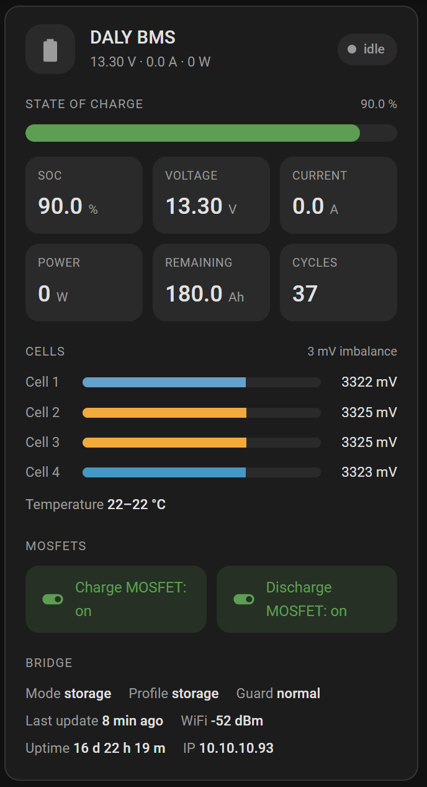

# DALY BMS Lovelace card

A dashboard card in the style of [ha-plex-info](https://github.com/smefa/ha-plex-info). It
shows the state of charge, voltage/current/power tiles, one bar per cell (highest and lowest
highlighted), temperatures, the two MOSFET switches and the bridge's mode, profile, guard,
WiFi and uptime. A banner warns when the BMS has stopped answering (`BMS data fresh` off) or
the low-voltage guard is counting down.



## Install

<a href="https://my.home-assistant.io/redirect/hacs_repository/?owner=smefa&repository=DalyBMS-to-MQTT&category=plugin" target="_blank">
  
</a>

1. Open **HACS** in Home Assistant.
2. Click the three dots in the top-right corner → **Custom repositories**.
3. Add `https://github.com/smefa/DalyBMS-to-MQTT` with category **Dashboard**.
4. Search for **DALY BMS card** in HACS and download it.
5. Reload the browser page. HACS registers the resource itself.
6. Add the card to a dashboard:

```yaml
type: custom:daly-bms-card
title: Caravan battery
# device_id: your_mqtt_device_id
```

Without HACS: copy `dist/daly-bms-card.js` to `/config/www/`, add `/local/daly-bms-card.js`
as a *JavaScript module* under **Settings > Dashboards > ⋮ > Resources**, then add the card as above.

The card finds the MQTT device named **DALY BMS** and its entities by the end of the
entity ID (`..._pack_voltage`, `..._cell_1` and so on, as Home Assistant creates them from
the discovery names). If you renamed an entity ID, map it by hand. Pick another device with
`device_id`, and map single entities with `entities`:

```yaml
entities:
  voltage: sensor.my_pack_voltage
  charge_mos: switch.my_charge_switch
```

Keys: `voltage current power soc remaining_ah cell_max_mv cell_min_mv cell_delta_mv temp_max
temp_min state cycles charge_mos discharge_mos bms_ok stale_s guard rssi uptime ip mode profile`.

Options: `cell_min_mv` / `cell_max_mv` (cell bar scale, default 2500-3700), and
`show_header show_summary show_status show_soc show_tiles show_cells show_temps show_switches
show_info`, each `true` or `false`.

Clicking a tile or cell opens its entity details. Clicking a MOSFET button toggles the switch
(Home Assistant's `switch` service; switching off asks first). It needs the bridge to be
listening: see [Switching the MOSFETs](../docs/mqtt.md#switching-the-mosfets).

## Test

```sh
node --test homeassistant/daly-bms-card.test.cjs
```
